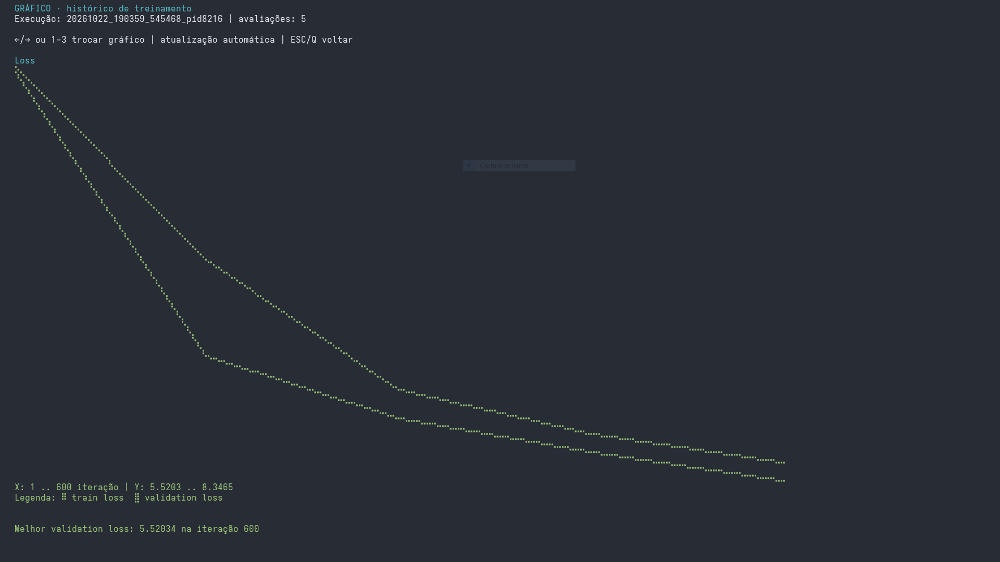

  🤖 AbrobaGPT: LLM from Scratch in PyTorch

  Python (https://img.shields.io/badge/python-3.10+-blue.svg)
  PyTorch (https://img.shields.io/badge/PyTorch-2.0+-ee4c2c.svg)
  License (https://img.shields.io/badge/license-MIT-green.svg)

  AbrobaGPT é uma implementação completa de um Large Language Model (LLM) construído do zero utilizando PyTorch. O
  projeto fornece um ecossistema robusto para todo o ciclo de vida de um modelo de linguagem: desde a curadoria de
  datasets e tokenização até o treinamento, avaliação quantitativa e uma interface de usuário sofisticada via terminal
  (TUI).

  

    
     
    <i>Interface Principal (TUI) desenvolvida com Curses</i>
  

  🌟 Principais Características

  🏗️ Arquitetura e Treinamento

  - Implementação Pure PyTorch: Arquitetura Transformer implementada do zero.
  - Pipeline de Dados: Suporte a streaming de datasets do HuggingFace e processamento de arquivos locais.
  - Otimizações de Treino:
    - AMP (Automatic Mixed Precision): Treinamento acelerado com menor consumo de VRAM.
    - Early Stopping: Monitoramento de validation loss para evitar overfitting.
    - Learning Rate Presets: Esquemas de cosine decay e presets configuráveis.
    - Checkpoints: Sistema de salvamento e retomada automática de treinamento.

  🧪 Avaliação e Qualidade

  - Benchmark Interno: Sistema de avaliação com presets JSON para testar:
    - Conhecimento Geral 🌍, Programação e Lógica 💻, e Escrita em Português ✍️.
  - Métricas Detalhadas: Cálculo de perplexidade, taxa de repetição e diversidade de tokens.

  🖥️ Interface do Usuário (TUI)

  Uma interface de terminal rica que transforma a experiência de desenvolvimento:

  

     &nbsp;&nbsp; 
     
    <i>Chat em tempo real e Visualização de métricas via Braille</i>
  

  - Configuração Visual: Ajuste de hiperparâmetros sem editar arquivos JSON manualmente.
  - Monitoramento: Barras de progresso e logs de saída em tempo real.
  - Chat Interativo: Interface de conversação com suporte a streaming de tokens.

  📁 Estrutura do Projeto

  ├── data/               # Scripts de download, preparação e arquivos de corpus
  ├── src/                # Core do projeto (modelo, tokenizer, inferência, avaliação)
  ├── training_logs/      # Logs de métricas e histórico de treinos
  ├── evaluation_presets/# Conjuntos de perguntas para benchmarking
  ├── web/                # Interface web complementar (estática)
  ├── main.py             # Ponto de entrada para a TUI
  └── train.py            # Script de execução do treinamento

  🚀 Como Começar

  Pré-requisitos

  - Python 3.10+
  - GPU NVIDIA com CUDA instalado (recomendado)

  Instalação

  1. Clone o repositório:
  git clone https://github.com/seu-usuario/abrobaGPT.git
  cd abrobaGPT
  2. Instale as dependências:
  pip install -r requirements.txt

  Executando a Interface

  Para abrir o painel de controle do AbrobaGPT:
  python main.py

  🛠️ Fluxo de Trabalho Sugerido

  1. Preparação: Use a tela Preparar Dataset para baixar o corpus (ex: RAG QA PT-BR).
  2. Configuração: Ajuste as camadas e learning rate na tela Configurações.
  3. Treino: Inicie o treinamento e monitore a perda na tela Monitor de Processo.
  4. Teste: Use a tela Testar Checkpoints para comparar versões do modelo via benchmarks.
  5. Uso: Abra o Chat Interativo e converse com seu modelo local!

  📈 Tecnologias Utilizadas

  - Linguagem: Python
  - Deep Learning: PyTorch
  - Manipulação de Dados: NumPy, Datasets (HuggingFace)
  - Interface: Curses, Colorama
  - Utilitários: Tqdm, JSON

  ---
  Desenvolvido para estudo aprofundado de arquiteturas de Transformers e processamento de linguagem natural.

  ---
